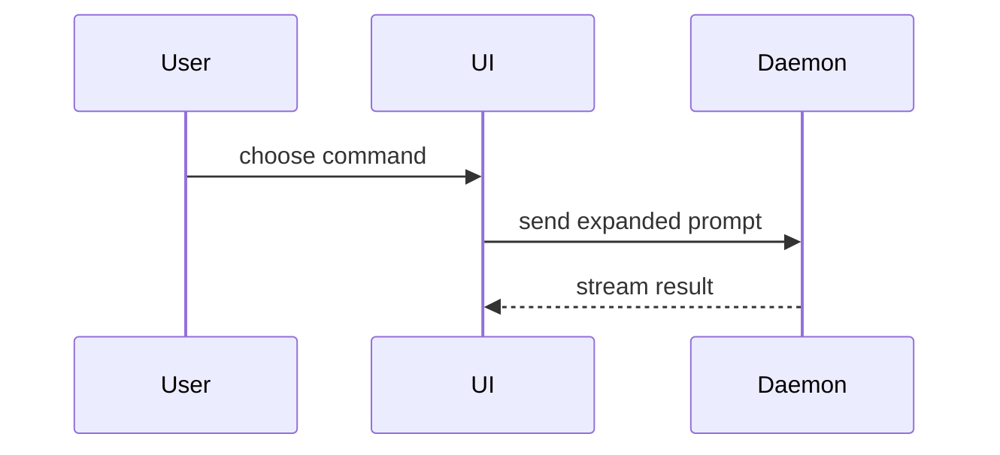

Open one real PR whose title and description a busy reviewer can read in ten seconds.

## Steps

1. Check if a PR already exists for this branch (`gh pr list --head <branch>`). If it does, update it.
2. Commit any uncommitted work that belongs to the change (`git status` first, then commit). Push the branch with `git push -u origin HEAD`.
3. Gather context: the diff against the base, usually `origin/main` (`git diff <base>...HEAD`), the commit messages (`git log <base>...HEAD --format="%s"`), the changed files, and the conversation that led here. Confirm the diff matches the goal and holds nothing unrelated.
4. Read the titles of a few recently merged PRs and copy their format.
5. Write a title that says what changed for the user and why it matters, not which function moved. Use the conversation context to inform the description, since the diff rarely carries the why. Example: "Cut websocket frames by 70% with compression" beats "Negotiate permessage-deflate". Max 72 characters.
6. Write the body with the template below. Keep it one screen.
7. Scan the title, body and any attachments for secrets, tokens, private paths and personal data. Remove them.
8. Create the PR as ready for review, not a draft, so review bots run.
9. Print the PR URL that GitHub returned.

## Body template

```markdown
## Summary

<diagram, diff-sketch, or tree>

## Evidence

- **Before:** <screenshot/output/failing test run>
  **After:** <screenshot/output/passing test run>

## Merge Danger

**Door:** <one-way or two-way>

<optional: description>

**Blast Radius:** <one-word description>

<optional: potential ramifications of merge>
```

Skip all preambles, keep prose brief, and use the user's domain language from `GLOSSARY.md`.

**Summary.** Pick the smallest view that makes the key point clear:

- pseudocode, for logic or an algorithm:

```text
on(save)
  if content is unchanged
    return cached result
  write new content
  return fresh result
```

- a call tree, for runtime control flow:

```text
submitForm
  createSession
    persistPrompt
    launchAgent
  navigateToSession
```

- a component tree, for UI structure, with the state and module boundaries that matter:

```text
<SessionPage> (apps/example/src/routes/session.tsx)
  useSessionEvents()
  <SessionToolbar>
    <RunSkillButton> (packages/ui)
```

- a shallow file tree, for file responsibility or a broad refactor:

```text
src/
├── commands/       # parses user actions
├── sessions/       # owns session state
└── transport/      # sends API requests
```

- a Mermaid `sequenceDiagram`, for component interaction, control flow or data flow:



- a `diff` of that shape when the surrounding structure already exists and the point is what changes. Match the shape to the topic.

For a component change:

```diff
 <SessionPage>
   useSessionEvents()
   <SessionToolbar>
+    <RunSkillButton />
   <SessionTimeline>
+    <SkillResultCard />
```

For a file-layout change:

```diff
 src/
 ├── commands/
+│   └── show-me.ts       # expands the slash command
 ├── sessions/
-└── transport.ts
+└── transport/
+    ├── client.ts
+    └── stream.ts
```

For a call-tree or call-stack change:

```diff
 submitForm
   createSession
     persistPrompt
+    expandSkillMention
     launchAgent
-  navigateToSession
+  navigateToSession
+    subscribeToEvents
```

For a state or control-flow change:

```diff
 on(save)
-  write content
+  if content is unchanged
+    return cached result
+  write new content
+  invalidate cache
```

- the whole block, when most of it is new or omitted context would hide ownership or order:

```ts
function expandSkill(command: string): string {
  const skillName = command.slice(1);
  return `use the ${skillName} skill`;
}
```

Place each visual next to the short text it supports. Keep only the calls, files, props, states and boundaries needed to answer the reader's question. Use one, or several; it is unlikely you need all of them.

**Evidence.** Concrete proof the change works, before and after. Screenshots are S-tier when the change is visual. Execution-based evidence is A-tier: test results, console output, the exact test that now fails and then passes.

**Merge Danger.** One-way or two-way door: a two-way door is cheap to roll back, a one-way door involves destructive actions or a hard-to-reverse decision. Blast radius is the scope of the impact — layout shift, broken consumers, mobile responsiveness. Pre-mortem the merge before you write it: "it breaks in a week; top 3 reasons?" (update overwrites config, not enabled at boot, no recovery path).

**Closing line.** End the body with `Created with <model> in <harness>.` Use the model name the harness reports; if it reports none, name only the harness. Never guess a model name.

## Stop when

- GitHub returned a PR URL. Hand off to `ds-watch-pr` if the user asked for watching.
- `gh pr create` fails twice. If the error is a GraphQL rate limit, retry once through REST: `gh api repos/<owner>/<repo>/pulls -f title=... -f head=... -f base=... -F body=@body.md`. If that fails too, fall back to `gh pr create --web --title "<title>" --body "<body>"` and hand the URL back when the browser opens. Report the error if the browser cannot open either.

## Rules

- No file-by-file change lists in the description.
- Do not post follow-up comments unless the request needs one. Use `ds-pr-comments` when it does.
- Body only, no PR needed: the template in `## Body template` is the whole answer for a PR someone else will file.
